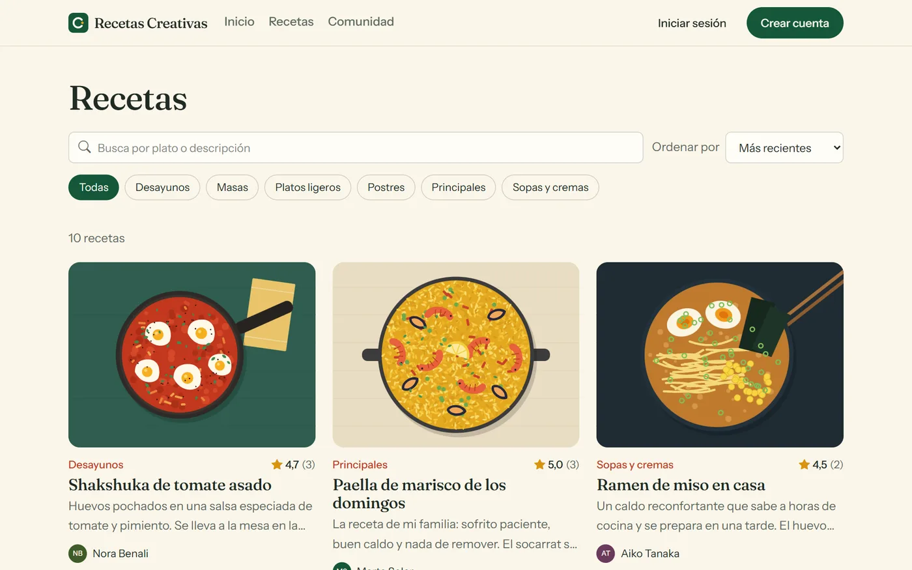
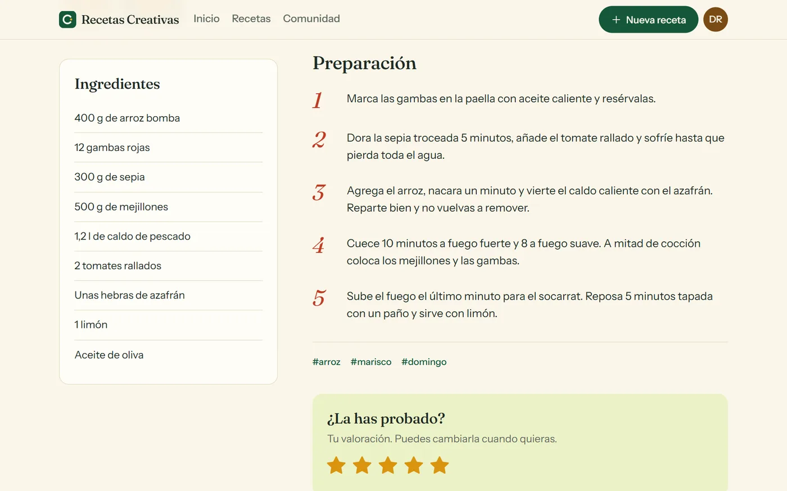
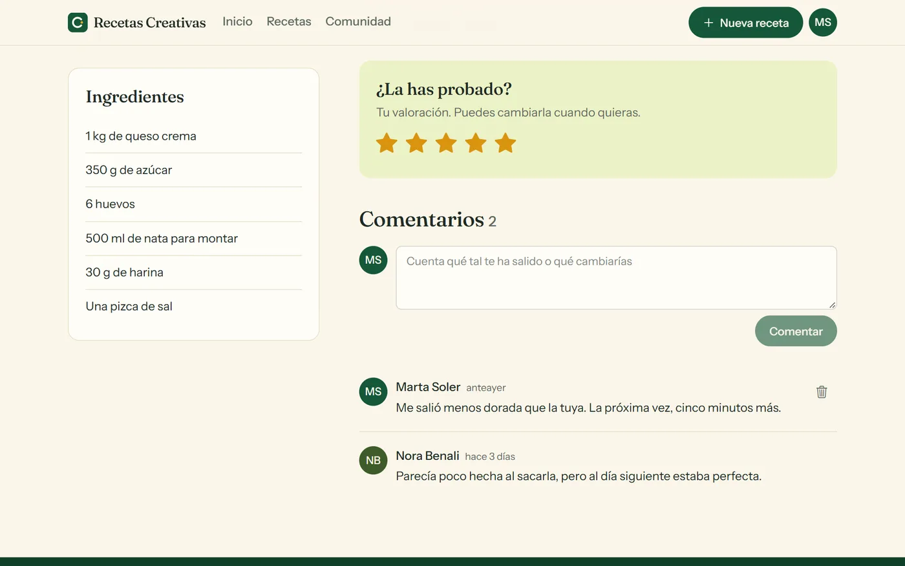
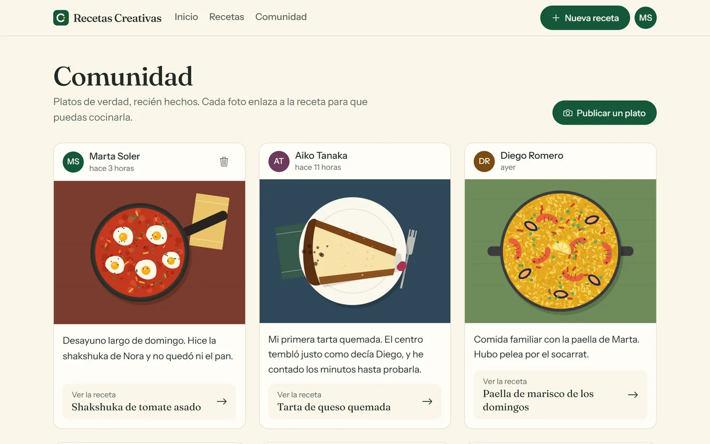
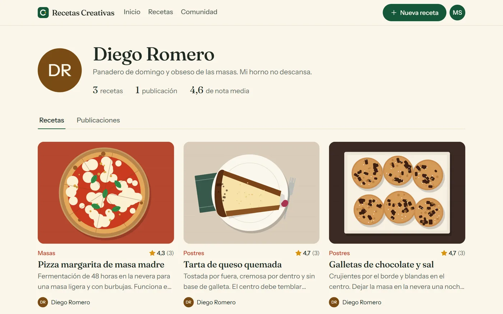
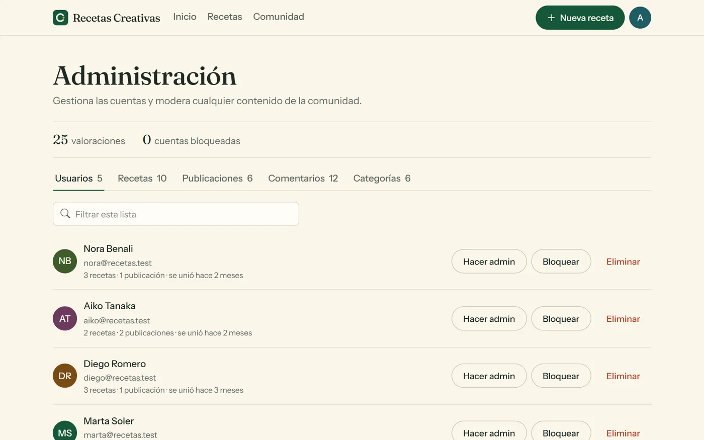
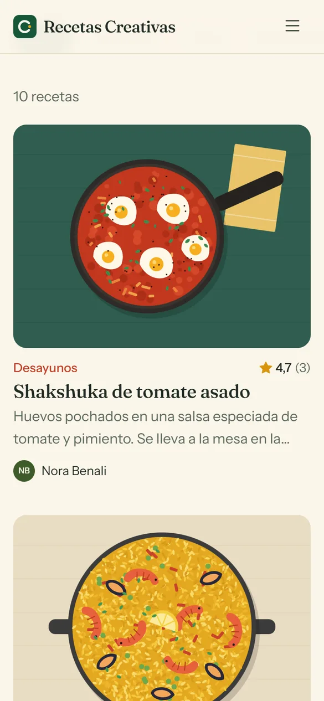
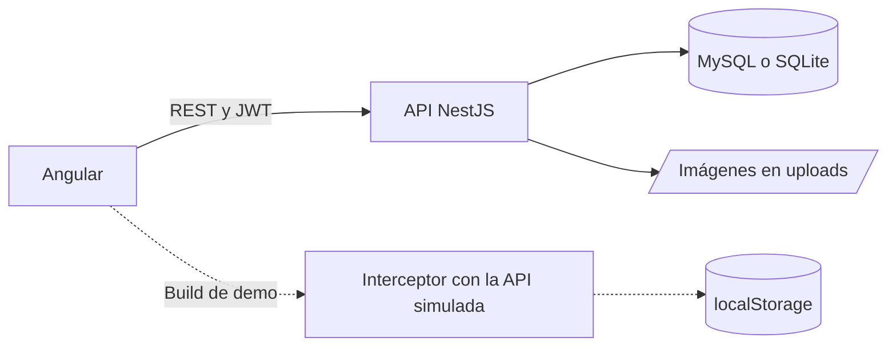
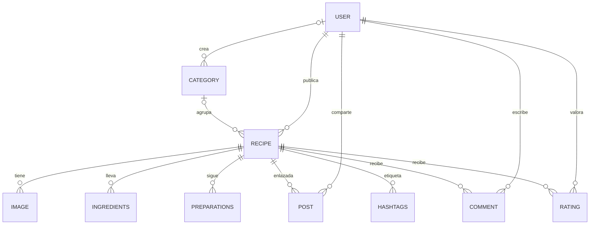

# Recetas Creativas

Comunidad de cocina casera: sube tus recetas, valora las de otras personas con estrellas, coméntalas y publica fotos de tus platos con un enlace directo a su receta.

**[Ver la demo](https://vanerb.github.io/recipeapp-nest-angular/)**: funciona sin instalar nada y sin registrarse.


**Stack:** Angular 17 · Tailwind CSS · NestJS 11 · TypeORM · MySQL o SQLite · JWT

## Funcionalidades

- **Recetas:** crear, editar y borrar, con varias fotos, ingredientes, pasos reordenables, categoría y etiquetas.
- **Búsqueda:** por texto, categoría y etiqueta, con orden por novedad o por nota. Los filtros viven en la URL, así que se pueden compartir.
- **Valoraciones:** de 1 a 5 estrellas, una por persona y receta. Nadie puede valorar las suyas.
- **Comentarios:** los puede borrar quien los escribió o el dueño de la receta.
- **Comunidad:** publicaciones con foto y texto, cada una enlazada a una receta.
- **Perfiles públicos:** presentación, foto, estadísticas, recetas y publicaciones.
- **Cuenta:** registro, inicio de sesión, edición de perfil, cambio de contraseña y borrado de cuenta.
- **Administración:** panel para bloquear o eliminar cuentas, nombrar administradores y moderar todo el contenido.

Leer es público; para participar hace falta iniciar sesión.

## Capturas

| Recetas | Detalle de una receta |
| --- | --- |
|  |  |

| Valoraciones y comentarios | Comunidad |
| --- | --- |
|  |  |

| Perfil público | Administración |
| --- | --- |
|  |  |

<p align="center">
  
</p>

## Puesta en marcha

Necesitas Node 20 o superior. No hace falta instalar una base de datos: sin `DB_HOST` en `backend/.env`, la API usa un fichero SQLite.

**API**, en `http://localhost:3002`:

```bash
cd backend
npm install
npm run seed
npm run start:dev
```

**Web**, en `http://localhost:4200`, desde otra terminal:

```bash
cd frontend
npm install
npm start
```

### Cuentas de prueba

Todas usan la contraseña `Demo1234!`.

| Correo | Rol |
| --- | --- |
| `admin@recetas.test` | Administración |
| `marta@recetas.test` | Usuario |
| `diego@recetas.test` | Usuario |
| `aiko@recetas.test` | Usuario |
| `nora@recetas.test` | Usuario |

Son solo para probar: su contraseña es pública, así que no uses estos datos en producción.

### Con MySQL

[recetas_demo.sql](database/recetas_demo.sql) trae los mismos datos de ejemplo: 5 usuarios, 10 recetas con imágenes, valoraciones, comentarios y publicaciones. Crea la base `recetas_demo` y no toca ninguna otra; si ya existe una con ese nombre, sus tablas se sustituyen. Se importa desde la raíz del proyecto:

```bash
mysql -u root -p --default-character-set=utf8mb4 -e "source database/recetas_demo.sql"
```

También se puede importar desde phpMyAdmin o MySQL Workbench. Después, configura `backend/.env` con `DB_HOST`, `DB_PORT`, `DB_USER`, `DB_PASS` y `DB_NAME=recetas_demo`. Si prefieres empezar con una base vacía, basta con crearla: la API genera las tablas al arrancar.

## Arquitectura





```text
backend/     API de NestJS: módulos, entidades, seed y tests
frontend/    Web de Angular y build de demo
database/    Base de datos de prueba para MySQL
docs/        Capturas de este README
```

Cada parte tiene su propia documentación: [backend](backend/README.md), con las variables de entorno y los endpoints, y [frontend](frontend/README.md), con la estructura y los scripts.

## Decisiones técnicas

- **Demo sin servidor.** Un interceptor HTTP responde a las mismas rutas que la API dentro del navegador, a partir de los mismos datos que usa el seed. El resto de la app no sabe que no hay backend, y se puede publicar en cualquier hosting estático.
- **Sin configuración para empezar.** El motor de base de datos se elige por variables de entorno, así que el proyecto arranca con SQLite y pasa a MySQL sin cambiar código.
- **Los permisos los decide la API.** Cada operación comprueba quién la pide; ocultar un botón en la web es solo comodidad. Contraseñas y correos se excluyen de las respuestas públicas en la propia entidad.
- **Administración que no se bloquea sola.** Nadie puede bloquearse, degradarse ni eliminarse desde el panel, y la última cuenta de administración no puede darse de baja.
- **Subidas restringidas.** Solo se aceptan JPG, PNG, WebP y GIF de hasta 5 MB, con nombres generados en el servidor. SVG queda fuera porque puede contener scripts.

## Tests

```bash
cd backend
npm run test:e2e
```

Los 20 tests recorren la API completa contra SQLite en memoria: permisos, validación, subidas, valoraciones, administración y borrados en cascada.

## Limitaciones conocidas

- El frontend no tiene tests automáticos.
- Los listados no están paginados.
- Las imágenes se guardan en el disco del servidor, así que un despliegue real necesitaría almacenamiento persistente.
- La administración no guarda un historial de sus acciones, y los borrados no se pueden deshacer.

## Créditos

Las ilustraciones de los platos de ejemplo se han creado para este proyecto. Desarrollado por [vanerb](https://github.com/vanerb).
